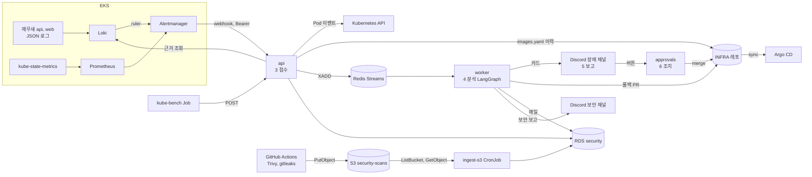

# OPS-maemusae

매무새의 AI 장애 대응 자동화입니다. Alertmanager 경보를 받아 근거를 붙이고, 분류하고, 런북을 찾고, 필요하면 원인을 분석해 Discord 장애 카드 한 장으로 알립니다. 배포 직후 장애면 런북 안내든 원인 분석이든 카드에 롤백 버튼이 붙고, 승인 역할을 가진 사람이 누르면 INFRA 레포의 롤백 PR이 리뷰 없이 merge됩니다. Discord 승인이 사람 리뷰입니다. 같은 워커가 보안 스캔 결과를 하루에 한 번 요약해 보안 채널에 올립니다.

레포를 나눈 이유는 [SPEC adr/0001](https://github.com/saebyeok-baesong/SPEC-maemusae/blob/main/adr/0001-repo-structure.md)에 있습니다. Alertmanager payload 예시는 [SPEC fixtures](https://github.com/saebyeok-baesong/SPEC-maemusae/tree/main/fixtures)에, `images.yaml` 계약은 [SPEC contracts](https://github.com/saebyeok-baesong/SPEC-maemusae/tree/main/contracts)에 둡니다. 이 레포에는 쿠버네티스 매니페스트가 없습니다. 클러스터에 올리는 정의는 INFRA 레포 `gitops/`에 두고, 거기에 필요한 것은 [docs/infra-requirements.md](docs/infra-requirements.md)에 적었습니다.

## 흐름



| 단계 | 하는 일 | 코드 |
| --- | --- | --- |
| 1 감지 | 5xx 비율, 처리 못 한 예외(Loki 규칙), CrashLoop, OOMKilled. 규칙은 INFRA에 둔다 | [docs/alerting.md](docs/alerting.md) |
| 2 전달 | Alertmanager가 같은 장애를 묶고, 예외 경보가 뜨면 5xx 경보를 막고, Bearer 토큰으로 보낸다 | [docs/alerting.md](docs/alerting.md) |
| 3 접수 | payload 파싱, 지문 중복 제거, 스택트레이스와 Pod 로그, Pod 이벤트, 직전 배포를 붙여 큐에 넣고 202 | `app/main.py`, `app/alerts.py` |
| 4 분석 | 분류(경량 모델, 지문 캐시) -> 런북 검색(pgvector + 키워드) -> 코드 수정이 필요하면 원인 분석(고성능 모델). 장애당 비용 상한 | `app/graph/`, `app/llm/`, `app/rag/` |
| 5 보고 | 장애 카드 한 장. 요약, 근거, 런북 링크, 배포 직후면 롤백 버튼 | `app/discord/cards.py`, `app/worker.py` |
| 6 조치 | 승인 역할(처음에는 풀스택, 인프라, 보안팀) 중 하나를 가진 사람만 승인. PR이 `images.yaml` 그 앱 한 줄만 바꾸는지 다시 보고 merge하고 기록. 알림이 해소되면 카드에 해소 확인 | `app/rollback.py`, `app/approvals.py` |
| 보안 일일 보고 | CI 스캔은 S3에서, kube-bench는 api로 받아 비밀값 없이 security DB에 쌓고, 매일 9시(KST)에 요약해 보안 채널에 올린다 | `app/security/`, [docs/security-reports.md](docs/security-reports.md) |

## 모듈

| 경로 | 내용 |
| --- | --- |
| `app/incident.py` | 장애(`Incident`), 근거(`Evidence`), 배포(`Deploy`), 큐 메시지(`AnalyzeJob`, `ResolvedJob`)의 모양 |
| `app/alerts.py` | Alertmanager payload 파싱과 알림 종류 표 `ALERT_KINDS`. 표 하나가 대상 라벨, 수집할 근거, 롤백 여부를 정한다 |
| `app/deploys.py` | INFRA `images.yaml` 계약(파싱, 한 줄 바꾸기)과 git 이력에서 직전 배포 찾기 |
| `app/rollback.py` | 롤백 제안 조건, PR 내용, 승인 처리(권한, 중복, 제안 뒤 변경 확인, PR diff 확인, merge) |
| `app/main.py` | api 진입점. 알림 webhook, kube-bench 결과 webhook, 장애 조회, `/healthz`, `/metrics` |
| `app/worker.py` | worker 진입점. 큐 소비, 그래프 실행, 롤백 PR 열기, 카드 게시, 해소 확인, 보안 보고 시각 확인 |
| `app/approvals.py` | approvals 진입점. Discord Gateway 봇. 버튼 클릭을 받아 `rollback.approve`를 부른다 |
| `app/graph/` | LangGraph 노드와 흐름. 체크포인터는 incident DB |
| `app/llm/` | 모델 분리와 응답 캐시(`router.py`), 비용과 예산(`cost.py`), 프롬프트, 출력 스키마, 가짜 LLM |
| `app/rag/` | 문단 경계 청킹, 임베딩 캐시, 증분 수집, 메타데이터 필터 + 벡터 + 키워드(RRF) 검색 |
| `app/sources/` | 바깥 시스템 클라이언트. Loki, Kubernetes 이벤트, GitHub App(INFRA) |
| `app/discord/` | Discord REST 클라이언트와 카드 빌더 |
| `app/security/` | 도구별 파서(Trivy, gitleaks, kube-bench), S3 수집 진입점(`ingest_s3.py`), security DB 저장, 일일 보고 |
| `app/core/` | 에러 지문, Redis Streams 큐, 장애 저장소 |
| `migrations/incident/`, `migrations/security/` | DB 두 개의 Alembic 마이그레이션 |
| `knowledge/` | 런북 원문. 워커가 시작할 때 바뀐 청크만 임베딩한다 |
| `tests/fixtures/alertmanager-webhook.json` | SPEC `fixtures/`의 사본. 바꿀 때는 SPEC부터 바꾼다 |

## 로컬에서 실행

준비물은 Docker와 Python 3.12입니다.

1. PostgreSQL(pgvector)과 Redis를 띄웁니다. 호스트 포트는 55432, 56379입니다.

   ```bash
   docker compose up -d postgres redis
   ```

2. 테스트를 돌립니다. LLM, GitHub, Discord, Loki, Kubernetes는 가짜라 외부 네트워크가 필요 없습니다.

   ```bash
   python3.12 -m venv .venv && .venv/bin/pip install -r requirements-dev.txt
   .venv/bin/python -m pytest
   ```

3. 전체 구성을 띄웁니다. `.env.example`의 기본값은 가짜 LLM이라 API 키가 없어도 됩니다.

   ```bash
   cp .env.example .env
   docker compose up -d --build api worker
   curl -X POST localhost:8000/api/v1/alerts/alertmanager \
     -H "Authorization: Bearer change-me" -H "Content-Type: application/json" \
     -d @tests/fixtures/alertmanager-webhook.json
   docker compose logs -f worker
   ```

   Discord 토큰이 없으면 카드 내용이 worker 로그에 `[discord disabled]`로 찍힙니다. 실제 채널로 보내려면 `.env`에 `DISCORD_*`를 채우고 `docker compose --profile discord up -d`로 승인 봇도 띄웁니다.

## 환경변수

전체 목록과 기본값은 `app/config.py`에 있습니다. 운영에서 꼭 넣는 값은 다음과 같습니다.

| 이름 | 쓰는 곳 | 내용 |
| --- | --- | --- |
| `ALERTMANAGER_TOKEN` | api | Alertmanager가 `Authorization: Bearer`로 보내는 값 |
| `SECURITY_REPORT_TOKEN` | api | kube-bench Job이 보내는 값. 장애 접수 토큰과 나눴다 |
| `REDIS_URL` | api, worker | 큐와 캐시 |
| `DATABASE_URL` | 전부 | RDS `incident`. 장애, 런북 벡터, LLM 호출, 조치, LangGraph 체크포인트 |
| `SECURITY_DATABASE_URL` | api, worker, ingest-s3 | RDS `security`. 스캔 결과, 일일 보고, 가져온 S3 키 |
| `OPENAI_API_KEY` | worker | LLM 호출 |
| `LIGHT_MODEL`, `HEAVY_MODEL` | worker | `openai:<모델>` 형식. 기본값은 쓰기 전에 OpenAI 모델 목록에서 확인한다 |
| `MODEL_PRICES` | worker | 100만 토큰당 [입력, 출력] USD. 비용 기록과 예산 상한의 근거 |
| `INCIDENT_BUDGET_USD` | worker | 장애 하나(또는 보안 보고 하루)의 LLM 비용 상한 |
| `LOKI_URL` | api | 스택트레이스와 Pod 로그 조회 |
| `DISCORD_BOT_TOKEN` | worker, approvals | 카드 게시와 버튼 수신을 같은 봇이 한다 |
| `DISCORD_INCIDENT_CHANNEL_ID`, `DISCORD_SECURITY_CHANNEL_ID` | worker | 장애 채널, 보안 채널 |
| `DISCORD_APPROVER_ROLE_IDS` | approvals | 승인 역할 ID, 쉼표로 나눈다. 하나라도 가진 사람이 승인한다. 처음에는 풀스택, 인프라, 보안팀 셋이고 나중에 줄인다. 비우면 아무도 승인하지 못한다 |
| `GITHUB_APP_ID`, `GITHUB_APP_INSTALLATION_ID`, `GITHUB_APP_PRIVATE_KEY` | api, worker, approvals | 롤백 App. INFRA 레포 읽기(배포 이력)와 쓰기(롤백 PR, merge). CI의 이미지 PR App과 다른 App이다 |
| `ROLLBACK_APPS`, `ROLLBACK_WINDOW_MIN` | worker | 롤백을 제안할 앱과 배포 뒤 시간 범위(기본 web, api와 30분) |
| `SECURITY_SCAN_BUCKET`, `AWS_REGION` | ingest-s3 | CI 스캔 결과 버킷(`maemusae-security-scans-<account_id>`). 자격은 Pod Identity |

## 지키는 것

- 같은 장애는 한 번만 분석합니다. 지문 중복 제거(Redis, 10분)와 열린 알림 확인(같은 Alertmanager fingerprint가 해소 전이면 새 장애를 만들지 않음)이 함께 막습니다.
- 같은 장애의 롤백은 한 번만 merge합니다. `actions (incident_id, action)` unique 제약이 동시 클릭도 막습니다.
- merge 직전에 다시 확인합니다. `images.yaml`의 그 앱 이미지가 제안 때와 다르거나 PR에 커밋이 더해졌으면 merge하지 않습니다.
- 롤백 App은 리뷰 없이 merge하므로 PR 모양도 확인합니다. base가 `main`이 아니거나, `images.yaml` 말고 다른 파일이 바뀌었거나, 그 앱 한 줄 말고 다른 줄이 바뀌었으면 merge하지 않고 카드에 거부 사유를 답니다.
- 봇이 되돌린 배포 뒤의 장애에는 롤백을 다시 제안하지 않습니다. 직전 이미지가 방금 되돌린 나쁜 이미지이기 때문입니다.
- 워커가 죽으면 다른 워커가 메시지를 회수하고 체크포인트에서 이어서 처리합니다. 카드는 한 번만 올라갑니다.
- gitleaks와 Trivy가 찾은 비밀값은 저장하지 않습니다. 규칙 ID와 위치만 남깁니다. gitleaks 결과는 모두 CRITICAL입니다.
- S3의 같은 스캔 객체는 한 번만 넣습니다. 가져온 키를 security DB에 unique로 남깁니다.
- Redis는 클러스터 안 Pod라 클러스터를 내리면 큐가 비워집니다. 받아들인 결정이고 영향은 [docs/infra-requirements.md](docs/infra-requirements.md#redis)에 있습니다.
